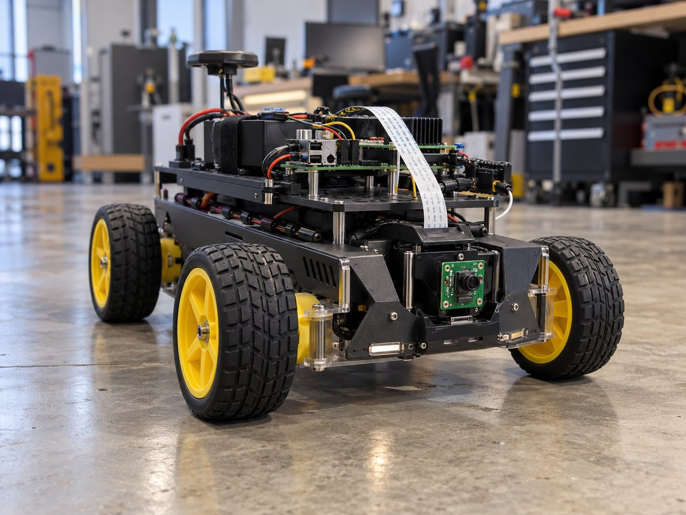
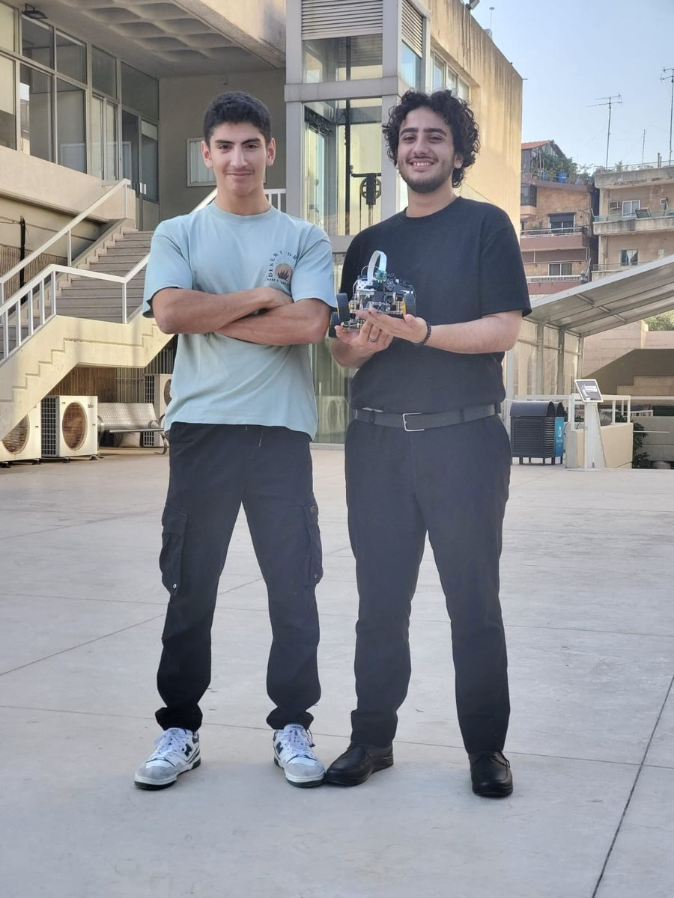
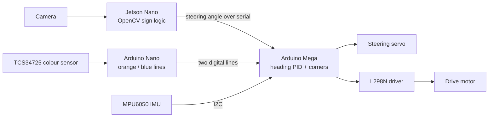
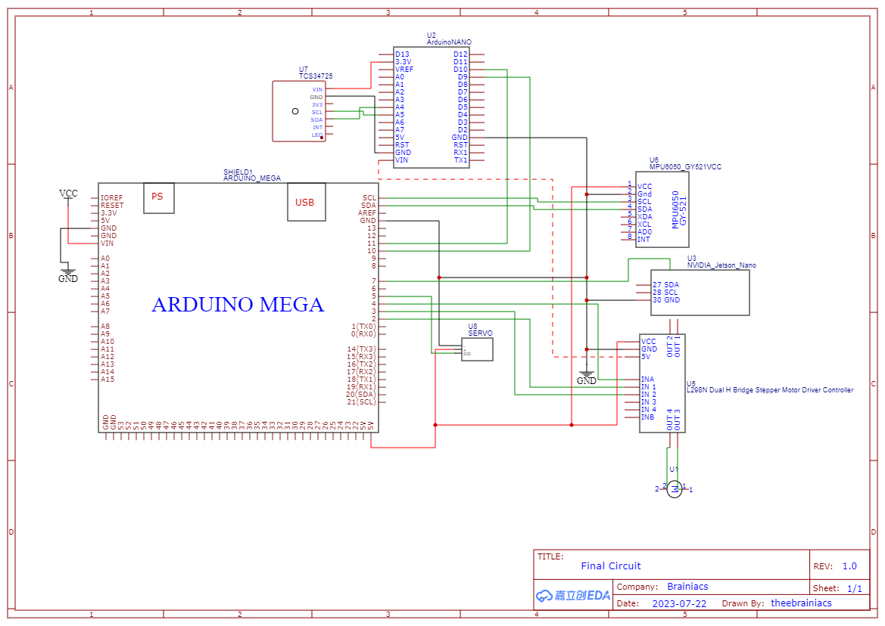

# Brainiacs autonomous race car

A small self-driving car I built with Wassim Ghaddar in twenty days for WRO Lebanon 2023, where it took second place in the Future Engineers category.




## What it is

The Future Engineers category of the World Robot Olympiad asks for a car that drives laps of a track on its own, turns at the corners, and passes coloured traffic signs on the correct side. We had twenty days from scratch.

Instead of asking one computer to do everything, I split the problem in two:

- A **Jetson Nano** runs the camera work in Python and OpenCV. It turns each frame into a single number, a steering angle, and sends that downstream.
- An **Arduino Mega** owns everything that has to happen on time: the steering PID, the drive motor, the IMU, and the corner logic. It never waits on a slow vision frame.

Vision is bursty: a hard frame or a change in exposure moves its timing around. Steering needs a steady cadence. Keeping the two on separate processors, with a tiny serial interface between them, is the decision the rest of the car was built around.

## Results

- **2nd place, Future Engineers**, WRO Lebanon 2023 (the national round of the World Robot Olympiad), July 2023.
- Built from scratch in **twenty days**.
- The whole national event had more than 95 teams and 250 participants across four categories.



## How it works



1. **See.** `src/jetson/vision_main.py` converts each frame to HSV, builds a mask for each sign colour, and keeps the nearest contour of each. It estimates distance from the sign's pixel height and bearing from the camera intrinsics, then adds a fixed offset so the car passes each colour on its own side. The result is one integer angle, written to the Mega over serial at 9600 baud.
2. **Sense the corners.** An Arduino Nano reads the TCS34725 colour sensor pointed at the mat and raises one of two digital lines when it sees an orange or a blue corner line (`src/arduino/nano/main.ino`).
3. **Steer.** The Mega (`src/arduino/mega/main.ino`) holds a heading set-point from the MPU6050's yaw and runs a PID loop on it to drive straight. When a corner line appears, it turns until the heading has moved by about 85 degrees and shifts the set-point. A mode pin decides whether the Mega steers from its own PID or from the Jetson's angle.
4. **Move.** The Mega drives the steering servo directly and the drive motor through an L298N H-bridge.

Calibration ended up being part of the software: the IMU gyro offsets are measured at start-up, the colour thresholds were sampled on the mat under the venue's lighting, the HSV ranges were tuned on real frames, and the PID gains (Kp 1.33, Kd 2.0, no integral) were tuned on the car. Those numbers were the difference between code that looked right and a car that finished laps.

## Hardware

| Part | Role |
|------|------|
| NVIDIA Jetson Nano | Camera processing and sign logic (Python, OpenCV) |
| Raspberry Pi Camera v2.1 | Vision input for the Jetson |
| Arduino Mega 2560 | Real-time control: heading PID, corners, motor and servo |
| Arduino Nano | Reads the colour sensor and flags corner lines to the Mega |
| MPU6050 IMU | Yaw for the heading PID and for timing the turns |
| TCS34725 colour sensor | Orange and blue corner-line detection |
| Geared steering servo | Steering |
| L298N dual H-bridge | Drive motor driver |
| Drive motor | Propulsion |
| 5 x 18650 Li-ion cells | Power, with a common ground across every board |

Wassim Ghaddar designed the hardware. The printable camera mount for the Jetson is in `CAD-models/`.

### Wiring



The MPU6050 and the TCS34725 are on I2C; the servo and the motor driver take PWM and direction pins from the Mega. The original file is [`schemes/Schematic circuit .png`](schemes/Schematic%20circuit%20.png).

## Running it

You need the Arduino IDE and a Jetson Nano with Python 3 and a camera.

**Arduino Mega and Nano**

1. Install the libraries listed in [`src/ArduinoLibraries.md`](src/ArduinoLibraries.md): `Adafruit_TCS34725`, `MPU6050_tockn` and `Servo` (`Wire` ships with the IDE). Copies of the versions we used are in `src/Arduino Libraries/`.
2. Flash `src/arduino/mega/main.ino` to the Mega (board: Arduino Mega 2560).
3. Flash `src/arduino/nano/main.ino` to the Nano.
4. Both print telemetry at 9600 baud: the Mega prints heading, set-point and the last Jetson angle; the Nano prints raw RGBC and the colour it decided on.

**Jetson Nano**

```bash
pip3 install -r src/jetson/requirements.txt   # opencv-python, numpy, pyserial
python3 src/jetson/vision_main.py
```

The serial port (`/dev/ttyACM0`), baud rate, HSV ranges and camera intrinsics are constants at the top of `vision_main.py`. Press `q` in the preview window to stop.

> Note: in the current file the final `main()` call has lost its indentation under `if __name__ == "__main__":`, so Python stops with an `IndentationError`. Indent that line before running.

## Repository layout

```
.
├── CAD-models/          printable Jetson camera mount (STL)
├── docs/                hardware and software notes, README images
├── project-report/      ReportWRO.docx, the competition report
├── schemes/             wiring schematic
├── src/
│   ├── arduino/mega/    main control firmware
│   ├── arduino/nano/    colour-sensor firmware
│   ├── jetson/          vision script and requirements
│   └── Arduino Libraries/   library snapshot
├── t-photos/            team photos
└── v-photos/
```

More detail on the hardware and the software lives in [`docs/hardware`](docs/hardware/README.md) and [`docs/software`](docs/software/README.md). The full competition report is [`project-report/ReportWRO.docx`](project-report/ReportWRO.docx).

## Limits and what's next

- Twenty days only leaves so much time to optimise or document each subsystem.
- The track and sign behaviour are tuned to the WRO Future Engineers 2023 field. Another track, mat or lighting needs new thresholds and new testing.
- Speed is a fixed PWM value. There are no wheel encoders, so there is no closed-loop speed control, and heading relies on gyro yaw, which drifts over a long run.
- The serial interface is one integer per line. A small framed protocol with telemetry back to the Jetson would make debugging easier.

If I picked it up again: wheel encoders for closed-loop speed, a MOSFET motor driver instead of the L298N, a config file for the thresholds and gains, and a watchdog on the serial link.

## Links and credits

- Project page: [ramikronbi.com/projects/brainiacs-autonomous-race-car](https://ramikronbi.com/projects/brainiacs-autonomous-race-car)
- Write-up: [Building an autonomous race car in twenty days](https://ramikronbi.com/writing/building-an-autonomous-race-car-in-twenty-days)
- RHU news: [RHU engineering students win big in the World Robotics Olympiad](https://www.rhu.edu.lb/media-room/news/rhu-engineering-students-win-big-in-the-world-robotics-olympiad)

Team Brainiacs, Rafik Hariri University (RHU):

- **Rami Kronbi**: all the software, integration, sensors and control
- **Wassim Ghaddar**: hardware design
- **Mohamad Al Kaderi**: coach

Released under the MIT License, see [`LICENSE`](LICENSE). Contributions are welcome, see [`CONTRIBUTING.md`](CONTRIBUTING.md).

Built by Rami Kronbi — [ramikronbi.com](https://ramikronbi.com)
